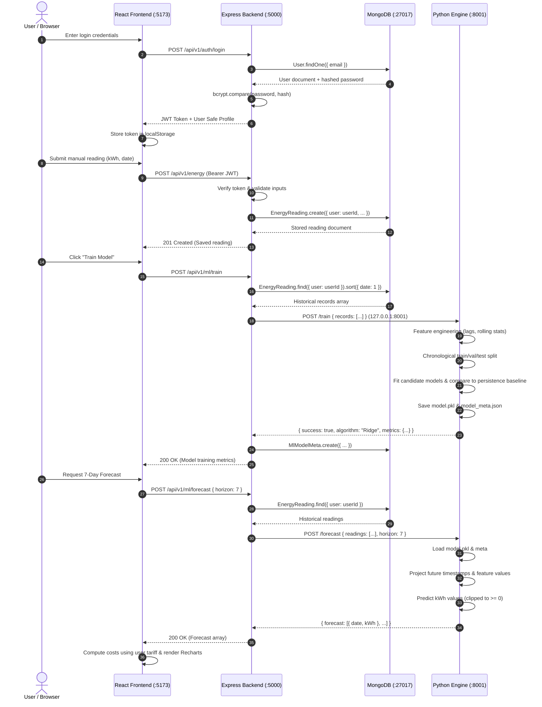

# WattWise AI — System Architecture Specification

## 1. System Overview

**WattWise AI** is an offline-first, local-first artificial intelligence platform designed to optimize electricity consumption in households, institutional hostels, and small commercial facilities. The system is designed to support **UN Sustainable Development Goal 7 (Affordable and Clean Energy)** and **SDG 12 (Responsible Consumption and Production)**.

The application operates completely offline without reliance on hosted cloud services, proprietary AI APIs (OpenAI, Anthropic, Google Gemini), or external database services. All data storage, feature engineering, model training, and inference occur strictly on the local machine (`127.0.0.1`).

---

## 2. Architecture Diagram

```mermaid
graph TD
    subgraph Client_Tier ["Frontend Client (React + Vite)"]
        UI["Web UI: Dashboard, Energy CRUD, Analytics, Forecast, Anomalies, Goals, Reports, Settings"]
        State["State Management: React Context + Axios Interceptor"]
        Recharts["Interactive Visualizations (Recharts)"]
    end

    subgraph Backend_Tier ["Backend Application Server (Node.js + Express)"]
        API["REST API Router (Port 5000)"]
        AuthMiddleware["JWT Authentication & Ownership Verification"]
        InputValidator["Express-Validator Input Sanitization"]
        CostCalc["Cost & Tariff Engine (costCalculator.js)"]
        RecEngine["Rule-Based Recommendations Engine"]
        MLBridge["ML Engine Client (HTTP Client on 127.0.0.1)"]
    end

    subgraph ML_Tier ["Machine Learning Engine (Python Flask - Loopback Only)"]
        MLServer["Flask Microservice (Port 8001 - 127.0.0.1 Only)"]
        DataLoader["Data Preprocessor & Validator"]
        FeatureEng["Time-Series Feature Pipeline (Lags & Rolling Windows)"]
        ModelTrainer["Model Trainer & Model Selector (Ridge, RF, HistGB)"]
        InferenceEngine["Forecasting Engine (predict.py)"]
        AnomalyDetector["Statistical Anomaly Detector (IQR, Rolling, IsolationForest)"]
    end

    subgraph Data_Tier ["Local Database & Artifact Store"]
        MongoDB[("Local MongoDB Community Edition (Port 27017)")]
        ModelStore[("Local Artifacts: model.pkl, model_meta.json")]
    end

    %% Communications
    UI -->|HTTP / JSON (Port 5000)| API
    API --> AuthMiddleware
    AuthMiddleware --> InputValidator
    InputValidator --> CostCalc
    InputValidator --> RecEngine
    InputValidator --> MongoDB
    InputValidator --> MLBridge

    MLBridge -->|Loopback HTTP / JSON (Port 8001)| MLServer
    MLServer --> DataLoader
    DataLoader --> FeatureEng
    FeatureEng --> ModelTrainer
    FeatureEng --> InferenceEngine
    FeatureEng --> AnomalyDetector
    ModelTrainer --> ModelStore
    InferenceEngine --> ModelStore
```

---

## 3. Technology Stack & Architectural Roles

| Layer | Technology | Version | Architectural Responsibility |
|---|---|---|---|
| **Frontend** | React.js | 19.x | Component-driven UI, state management, reactive routing |
| **Build Tool** | Vite | 8.x | Lightning-fast HMR and bundle compilation |
| **Styling** | Tailwind CSS | 3.4.x | Consistent, responsive, accessible design system |
| **Charts** | Recharts | 3.x | SVG-based responsive data visualizations |
| **Backend API** | Node.js + Express | 18+ / 4.21.x | Versioned REST API endpoints, security, validation |
| **Authentication** | JWT + bcryptjs | 9.x / 2.4.x | Stateless secure token auth and salted password hashing |
| **Database** | MongoDB + Mongoose | 8.x | Local document storage, schema validation, indexing |
| **ML Runtime** | Python | 3.10+ | Scientific computing, time-series analysis, ML training |
| **ML Framework** | scikit-learn | 1.5+ | Regressors (Ridge, RF, HistGB), preprocessing pipelines |
| **Data Processing** | pandas & NumPy | 2.2+ / 2.5+ | Vectorized tabular operations and feature computation |
| **Serialization** | joblib | 1.4+ | Compressed binary model persistence and reloading |
| **ML Server** | Flask | 3.0+ | Lightweight HTTP interface bound strictly to 127.0.0.1 |

---

## 4. Multi-Process Component Communication



---

## 5. Security Architecture & Isolation

1. **Loopback Binding Isolation:**
   - The Python ML inference service binds strictly to `127.0.0.1:8001`. It rejects external network connections and is accessible only by the local Node.js backend.
2. **Strict Multi-Tenant Isolation:**
   - Every reading, goal, and tariff setting is strictly keyed to the authenticated user's `ObjectId`.
   - Database queries always enforce `{ user: req.user._id }`.
   - Attempting to query or modify another user's record returns `404 Not Found`.
3. **Password Security:**
   - Passwords are salted and hashed using `bcrypt` with cost factor 12.
   - User passwords are excluded by default in Mongoose queries (`select: false`).
4. **Local Network Security:**
   - Helmet secures HTTP response headers.
   - CORS is restricted to the local frontend origin (`http://localhost:5173`).
   - Rate limiting protects endpoints against brute-force attacks (500 requests per 15 minutes per IP).

---

## 6. Machine Learning Pipeline Architecture

### Data Preprocessing & Validation
- Timestamps are normalized to UTC-naive datetime objects.
- Negative or non-numeric kWh values are purged.
- Identical timestamp duplicates are filtered to ensure uniform intervals.

### Leakage-Free Feature Engineering
Features are computed strictly from historical observations:
- **Calendar:** `hour`, `day_of_week`, `is_weekend`, `month`, `day_of_year`, `week_of_year`.
- **Lag Variables:** `lag_1` (prior day), `lag_7` (prior week), `lag_14` (two weeks prior).
- **Rolling Windows:** `rolling_mean_7`, `rolling_std_7`, `rolling_mean_14` computed on shifted data (`df['y'].shift(1)`) so the current observation is never included in its own feature vector.

### Chronological Splitting & Baseline Evaluation
- **Chronological Split:** 70% Training, 15% Validation, 15% Testing. No random shuffling.
- **Baseline:** Persistence model ($y_t = y_{t-1}$).
- **Candidate Models:**
  1. `Ridge Regression`: $L_2$-regularized linear regression with `StandardScaler`.
  2. `RandomForestRegressor`: Ensemble of decorrelated decision trees.
  3. `HistGradientBoostingRegressor`: Fast gradient boosting with binning.
- **Selection Criterion:** Candidate with minimum Validation MAE is selected and re-fit on combined Train+Val set before evaluation on the unseen Test set.
- **Artifact Storage:** Serialized using `joblib` into `ml-engine/models/model.pkl`.
